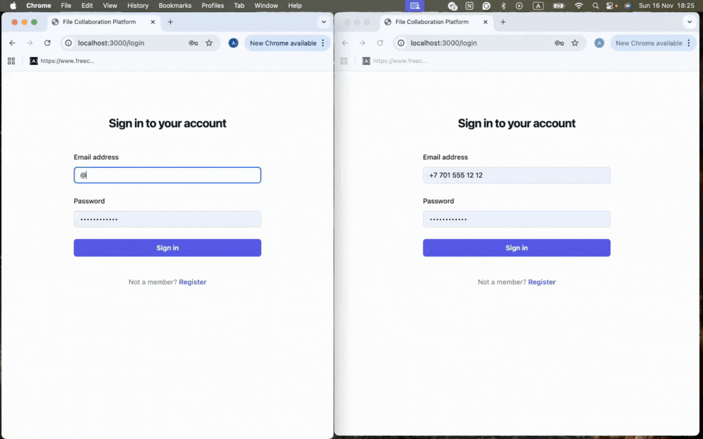

# File Collaboration System

[](https://github.com/aigerim-suleimenova/file_collaboration/actions/workflows/ci.yml)



A real-time collaborative rich-text editor. Upload a document (HTML or DOCX), edit it in the browser, and share a link so others can edit with you live. You see each other's cursors, and concurrent edits merge without conflicts.

## Features

- **Live co-editing:** Yjs CRDT sync over an authenticated WebSocket, with labelled cursors for each collaborator.
- **Saved collaborative state:** edits survive reloads and server restarts.
- **Share links:** time-limited tokens that let a guest open and edit one document.
- **Rich text:** a Quill 2 editor, plus DOCX ↔ HTML conversion and DOCX export.
- **Accounts:** sign-up and login with JWT, and bcrypt-hashed passwords.
- **Files in S3:** uploads are stored in S3; metadata and document state live in PostgreSQL.

## Tech stack

| Layer | Technology |
|---|---|
| Backend | FastAPI, SQLModel / SQLAlchemy 2, PostgreSQL 15, Alembic, `pycrdt-websocket` |
| Frontend | Vue 3 (Composition API), Pinia, Vue Router, Quill 2, `yjs` + `y-quill` + `y-websocket`, Tailwind CSS, Vite |
| Quality | pytest (+ coverage), flake8, ESLint, GitHub Actions |
| Runtime | Docker, Docker Compose, nginx (production frontend) |

## Quickstart

```bash
git clone https://github.com/aigerim-suleimenova/file_collaboration.git
cd file_collaboration
docker compose up --build
```

Open http://localhost:3000, register an account and upload a `.html` or `.docx` file. To try live editing, click **Share** and open the link in a second browser. The backend's health check is at http://localhost:8000/health. The database schema is created automatically on first start.

## How real-time collaboration works

1. **The editor connects** to `WS /api/v1/collab/{file_id}` on the FastAPI backend (the same service as the REST API). It passes `?token=<access token>` for the owner, or `?share_token=<share link token>` for a guest.
2. **The backend checks access before sending any document data.** The owner's access token or a matching, unexpired share token is accepted. Anything else is closed with `4001` (missing or invalid credentials), `4003` (no access to this file) or `4004` (no such file).
3. **Yjs CRDT sync** (`pycrdt-websocket` on the server, `y-websocket` + `y-quill` in the browser) merges concurrent edits with formatting intact. Yjs awareness shows each collaborator's labelled cursor.
4. **Saving:** the server saves the Yjs document state to Postgres (`file.yjs_state`) at most every 2 s while it is being edited, when the last editor leaves, and on shutdown.
5. **First open:** a document with no collaborative state is filled once from its stored HTML, after the first sync.
6. **Safety:** typed markup stays text, stored HTML is sanitized with DOMPurify before it is displayed, and tokens are redacted from server logs.

### Known limitations

- **Single backend process:** collaboration rooms live in memory, so the backend runs one uvicorn worker. Scaling out would need a shared message bus (for example Redis).
- **Share links grant edit access** until they expire (4 h by default). Access is checked when a connection opens, and there are no viewer/editor roles yet.
- **View mode shows the last saved HTML:** guest edits appear in the editor straight away, but in view mode only after the owner saves.
- **Two first openers:** if two people open a never-edited document at the same moment, its initial content can be loaded twice. This can only happen once per document.
- **Tokens travel in the WebSocket URL** (browsers can't set headers on WebSockets). They are redacted from server logs.

## Development without Docker

Requirements: Python 3.11, Node.js 18+, and PostgreSQL (the defaults expect `localhost:5433`, user `postgres`, password `12345678`, database `file_collaboration_db`, which is the compose database).

```bash
# Backend
cd backend
python3 -m venv .venv && source .venv/bin/activate
pip install -r requirements-dev.txt
alembic upgrade head
uvicorn app.main:app --reload --port 8000

# Frontend (second terminal)
cd frontend
npm install
npm run dev   # http://localhost:3000, proxies /api/v1 to localhost:8000
```

After changing a model, create a migration with `alembic revision --autogenerate -m "describe the change"`, then review it. CI fails if the models and migrations disagree.

## Running tests and linters

```bash
# Backend: unit and API tests (in-memory SQLite, S3 faked)
cd backend
pytest --cov=app --cov-report=term-missing
flake8 app tests

# Migration tests against a real, empty PostgreSQL database (optional locally, always run in CI)
TEST_POSTGRES_URL=postgresql+psycopg2://postgres:<password>@localhost:5432/<empty_db> pytest tests/test_migrations.py

# Frontend
cd frontend
npm run lint
npm run build
```

CI (`.github/workflows/ci.yml`) runs on every push to `prod`/`main` and on pull requests:
- flake8;
- the migration round trip and `alembic check` on PostgreSQL;
- pytest with coverage;
- ESLint with no warnings allowed;
- the frontend build;
- both production Docker images.

Any failure fails the run.

## API

All REST routes are under `/api/v1` except `/health`. Interactive docs: `/docs`.

| Method & path | Purpose |
|---|---|
| `GET /health` | Service and database status (200 / 503) |
| `POST /users/signup` | Register |
| `POST /login/access-token` | Log in (OAuth2 form) and get a JWT |
| `GET /users/me` | Current user |
| `GET /files/` | List your files |
| `POST /files/upload` | Upload a file (multipart) |
| `GET /files/{id}` | File metadata and editor content |
| `PUT /files/{id}` | Rename / update metadata |
| `DELETE /files/{id}` | Delete a file |
| `GET /files/{id}/content` · `POST /files/{id}/content` | Download / replace the stored file |
| `POST /files/{id}/update-quill-content` | Save the editor's HTML |
| `GET /files/{id}/download` | Pre-signed S3 download URL |
| `POST /files/{id}/share` | Create a share token |
| `POST /files/{id}/convert-to-docx` | Export to DOCX |
| `GET /public/files/{id}?token=...` | Open a shared file |
| `WS /collab/{file_id}?token=...` or `?share_token=...` | Real-time sync and presence |

Every file route is limited to the file's owner; other users get 404.

## Deployment

See [docs/deployment.md](docs/deployment.md) for environment variables and step-by-step guides for Docker Compose, Render and Railway.

## How this project is developed

Changes are planned and verified with [OpenSpec](https://github.com/Fission-AI/OpenSpec) while working with an AI coding agent. Each change has a proposal, behaviour specs, a design and a task list with a verification step per task. They live in [`openspec/`](openspec/): finished changes are under `openspec/changes/archive/`, and the current specs are under `openspec/specs/`.

## 📝 License

This project is licensed under the MIT License - see the [LICENSE](LICENSE) file for details.

## Acknowledgments

- **Yjs** for the CRDT framework, and **pycrdt** for its Python implementation
- **FastAPI**, **Vue.js** and **Quill** communities
